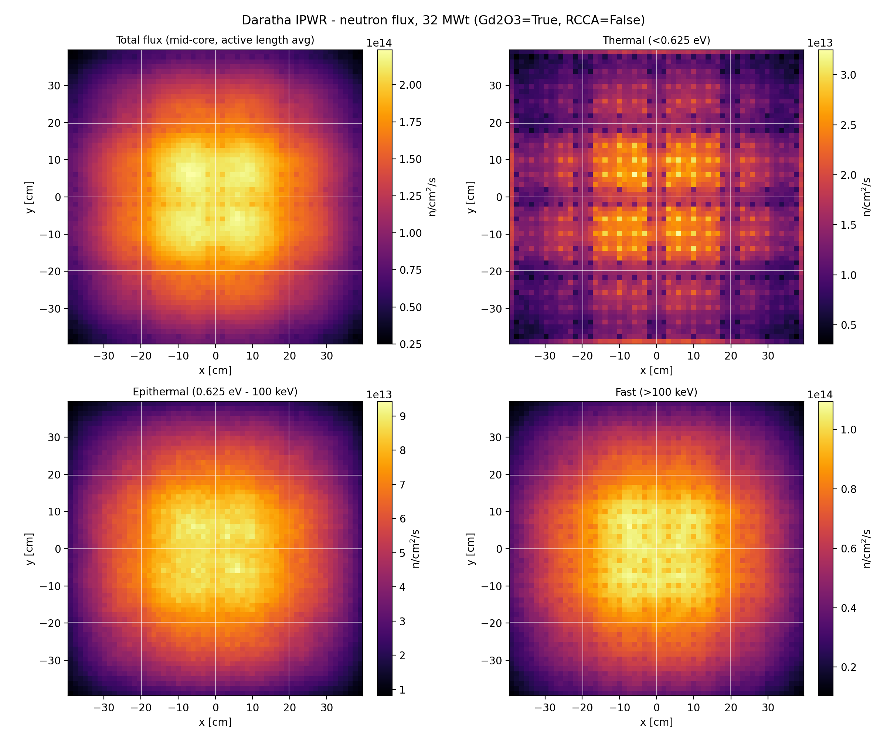

# Daratha Atomics 10 MWe IPWR — Basic OpenMC k-eff Model

This repo contains a basic OpenMC criticality model built from the parameters
published in Daratha Atomics' technical whitepaper, *"Engineering a
Factory-Manufactured 10 MWe Integral PWR for India"* (Technical Thesis and
Engineering Basis, September 2026).

**Result of the base-case run: k-eff ≈ 1.18**

This is a fresh-fuel, unrodded, unpoisoned k-eff — see [Why k-eff is
1.18](#why-k-eff-is-118-and-why-thats-expected) below before drawing any
conclusion from that number.

> **Disclaimer:** This is a scaffold for exploration, not a validated
> neutronics model. It was not built or reviewed by Daratha Atomics, has no
> connection to their internal design tools, and should not be used as a
> stand-in for the validated neutronics, thermal-hydraulics, and safety
> analysis the whitepaper itself (Section 3.4) identifies as still-required
> work.

---

## Files

| File | Purpose |
|---|---|
| `model.py` | Builds materials + geometry + settings, exports OpenMC XML, runs the k-eff eigenvalue calculation |
| `plot_geometry.py` | Imports `model.py` and produces three geometry plots (assembly close-up, full-core radial slice, axial slice) without running a transport calculation |
| `README.md` | This file |

## Requirements

- A local OpenMC installation (0.14+ — the model uses the current
  `openmc.model.RectangularPrism` API, not the deprecated
  `openmc.rectangular_prism` function)
- Nuclear cross-section data (e.g. ENDF/B-VIII.0), with
  `OPENMC_CROSS_SECTIONS` pointing at its `cross_sections.xml`

```bash
export OPENMC_CROSS_SECTIONS=/path/to/endfb-viii.0-hdf5/cross_sections.xml
python model.py            # runs the k-eff calculation
python plot_geometry.py    # writes assembly_xy.png, core_xy.png, core_xz.png
```

---

## What this model represents

A full 3D, pin-resolved model of the 4×4 fuel-assembly core described in the
whitepaper: 16 assemblies, each a 15×15 lattice of 204 fuel pins + 21
guide/instrument tubes, surrounded by a water reflector, core barrel,
downcomer, and RPV wall.

It is intentionally the **base case**: fresh 4 wt% UO2 fuel, no burnable
absorber, no control rods inserted, 0 ppm soluble boron, single fixed
temperature. No depletion, no thermal feedback, no uncertainty
quantification.

---

## Parameters taken directly from the whitepaper

| Parameter | Value | Section |
|---|---|---|
| Core layout | 4×4 assemblies | 2.1, Fig. 1 |
| Assembly lattice | 15×15 (204 fuel pins + 21 guide/control tubes) | 2.1 |
| Total fuel pins | 3,264 (16 × 204) | 2.1 |
| Fuel | UO2, 4 wt% U-235 | 2.1 |
| Heavy metal inventory | 1.744 tHM | 2.1 |
| Active fuel length | 1.10 m | 2.1 |
| Core width (4×4 array footprint) | 0.792 m | Fig. 1 |
| Equivalent core diameter | 0.893 m (verified: matches 0.792 m square exactly) | 2.1 |
| Core barrel ID | 1.15 m | Fig. 1 |
| RPV ID | 1.50 m | Fig. 1 |
| Downcomer annular width | ~15–16 cm | Fig. 1 |
| Primary pressure | 15.5 MPa | 2.2 |
| Core inlet / outlet temperature | 285 °C / 320 °C | 2.2 |
| Soluble boron | 0 ppm (baseline strategy) | 2.1 |

### Derived arithmetically from the above (not assumed)

- **Assembly pitch** = 0.792 m / 4 = **19.8 cm**
- **Pin pitch** = 19.8 cm / 15 = **1.32 cm**
- Consistency check: 204 + 21 = 225 = 15² ✓ (the paper's own pin/tube counts
  exactly fill a 15×15 lattice, and the 0.792 m core width divided into a 4×4
  array gives an equivalent diameter of 0.8937 m, matching the paper's stated
  0.893 m almost exactly)

---

## Parameters assumed (NOT in the whitepaper)

The whitepaper is a pre-conceptual technical basis. It gives core-level
quantities (pin counts, enrichment, heavy-metal mass, active length, vessel
envelope) but not the pin-level or material-level detail needed to build a
runnable transport model. Everything below was filled in using generic
PWR-family engineering values so the model would run, and is clearly
isolated at the top of `model.py` for easy replacement once real design
data exists.

| Parameter | Assumed value | Rationale |
|---|---|---|
| Fuel pellet OD | 0.92 cm | Typical fuel-to-clad ratio at a 1.32 cm pitch |
| Fuel–clad gap | 0.008 cm radial (He-filled) | Typical PWR gap |
| Clad OD | 1.075 cm | Typical clad thickness (~0.057 cm) for this pitch, P/D ≈ 1.23 |
| Clad material | Zircaloy-4 | Standard PWR cladding |
| Guide tube ID / OD | 1.10 / 1.20 cm | Scaled to pitch; not specified |
| **Guide/control tube layout** (which 21 of 225 lattice positions) | A generic, roughly symmetric pattern I constructed | The paper states the counts (204 + 21) but never publishes a lattice map |
| Fuel density | 10.4 g/cm³ | Typical ~96% theoretical density PWR UO2 |
| Coolant/moderator density | 0.72 g/cm³ | Approximate water density at core-average conditions (302.5 °C, 15.5 MPa) |
| Core-average temperature | 575.65 K (302.5 °C) | Paper gives inlet (285 °C) / outlet (320 °C) only, not a core-average |
| Assembly-to-assembly gap | 0 (edge-to-edge at the derived 19.8 cm pitch) | Not specified |
| Radial water reflector | Fills the core box out to the core barrel ID (1.15 m) | Dimensions from the paper; material choice (plain water) assumed |
| Core barrel thickness | 3.0 cm | Not specified |
| RPV wall thickness | 7.0 cm | Not specified |
| Axial water reflector | 30 cm above and below the active fuel | Not specified; typical assumption |
| Structural steel composition | SS304-like (Fe/Cr/Ni/Mn) | Not specified; generic reactor-grade stainless |
| Vessel head/bottom internals, penetrations | Not modeled | Out of scope for a basic k-eff model |

---

## What was explicitly NOT modeled (and why it matters for k-eff = 1.18)

The whitepaper names two specific reactivity-control features that this
model does **not** include:

> *"Burnable absorber — Candidate: 12 pins/assembly with 4.0 wt% Gd2O3;
> requirement still under review"*
> *"Control rods — 12 RCCAs; current design target SDM >5.5% delta-k/k with
> highest-worth rod stuck out"*

**Neither is modeled in this base case.** Specifically:

- **No Gd2O3 burnable absorber.** All 204 "fuel pin" positions per assembly
  are plain 4 wt% UO2 with no poison. The paper itself flags the Gd loading
  as an open, unresolved design decision ("still under review") — there is
  no fixed loading pattern to model yet, so I left it out rather than
  guessing one and presenting a guess as a design parameter.
- **No control rods / RCCAs.** All 21 guide tubes per assembly (across all
  16 assemblies) are modeled as empty, unrodded water channels. The paper
  gives a shutdown-margin *target* (>5.5% Δk/k, worst stuck-rod) but not the
  RCCA absorber material, geometry, or which of the 21 guide tubes per
  assembly actually hold control rods versus instrument/vacant tubes —
  nothing concrete to build a rod model from.
- 0 ppm soluble boron **is** modeled, but that's consistent with the paper's
  own stated zero-soluble-boron baseline strategy, not an omission.

### Why k-eff is 1.18, and why that's expected

With fresh 4 wt% enriched fuel, no burnable poison, no control rods
inserted, and no boron, this core is close to its maximum physically
achievable reactivity for this geometry. A k-eff around 1.15–1.20 for an
unpoisoned, unrodded fresh PWR-type core is unsurprising and not, by itself,
a statement about whether the final design is viable, over-moderated, or
under-controlled. It only tells you how much *negative* reactivity the
absorber and control systems will eventually need to supply — which is
exactly the coupled optimization the whitepaper's Section 3.3 describes as
still outstanding (enrichment, burnable absorber loading, RCCA worth, and
power peaking need to be solved together, not separately).

This base-case k-eff is a **reference point**, useful mainly as:
1. A sanity check that the geometry and fuel loading are behaving physically
   (positive reactivity margin, as any competent design would need before
   adding absorbers).
2. A baseline against which the reactivity worth of a Gd2O3 loading pattern
   or an RCCA bank can be measured, once those are added as separate model
   variants.

### What it would take to add these features

**Gd2O3 burnable absorber (12 pins/assembly, 4.0 wt%):**
Requires deciding (a) whether Gd2O3 is mixed homogeneously into the UO2
matrix of 12 of the 204 fuel-pin positions per assembly (an integral
burnable absorber, IFBA-style) or physically separate absorber pins, and
(b) which 12 of 204 positions. None of this is specified in the paper.

**12 RCCAs with SDM >5.5% Δk/k, worst stuck-rod:**
Requires (a) an absorber material (common PWR choices: Ag-In-Cd or B4C —
not stated in the paper), (b) which 12 of the 21 guide tubes per assembly
hold RCCAs versus instrument/vacant tubes, and (c) a rod-worth study: an
all-rods-in case, an all-rods-out case, and an N−1 "highest-worth rod stuck
out" case to actually check the >5.5% Δk/k target — this is a multi-run
study, not a single k-eff calculation, and is exactly the kind of validated
neutronics analysis the whitepaper's Section 3.4 lists as still-required
future work rather than something available at this stage of the design.

---

## Model limitations (full list)

- No burnable absorber, no control rods (see above)
- No depletion / burnup — fresh fuel only
- No thermal-hydraulic feedback — single fixed temperature throughout
- No uncertainty quantification on any assumed parameter
- Guide-tube lattice map is a generic placeholder, not the actual design
- Reflector/barrel/vessel thicknesses are assumed, not specified in the
  source document
- Not independently verified, not benchmarked, not reviewed against any
  licensing methodology

## Source document

Daratha Atomics Design Team, *"Technical Design Basis for a
Factory-Manufactured 10 MWe Integral PWR (IPWR): Core Physics,
Thermal-Hydraulics, Transportability Envelope, and Regulatory Alignment,"*
Baseline Version 2.0 (Post-Review Re-Baseline), September 2026. Confidential
document, restricted circulation.

## Flux Map (13-10-26)

